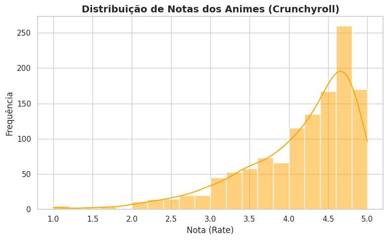
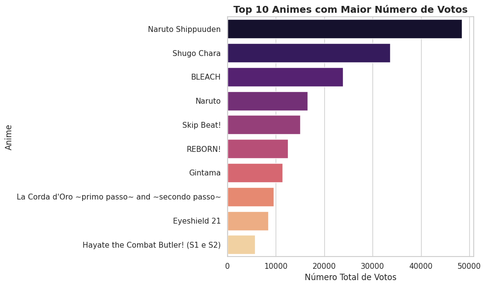

# Análise de notas e votos de animes da Crunchyroll

[](https://colab.research.google.com/github/teles-hub/Analise-de-Dados-com-Python/blob/main/analise_animes_crunchyroll.ipynb)

Análise exploratória em Python da base de avaliações de animes da Crunchyroll. O notebook responde a três perguntas:

1. Como se distribuem as notas e os votos dos animes na plataforma?
2. Quais são os animes mais populares (mais votados) e os mais bem avaliados?
3. Existe relação entre a quantidade de episódios e a nota recebida?

## Base de dados

[Crunchyroll Anime Ratings](https://www.kaggle.com/datasets/filipefilardi/crunchyroll-anime-ratings), do Kaggle. Na execução registrada no notebook, o arquivo `animes.csv` tinha **1.255 linhas e 41 colunas**: nome, número de episódios, votos, nota média (`rate`), contagem de votos por nota de 1 a 5 e colunas de gênero. A licença e a data de coleta estão na página do dataset.

O notebook baixa os dados com `kagglehub`, então o CSV não precisa ser enviado para o repositório. Os números abaixo vêm dos outputs salvos no próprio notebook; eles não foram recalculados em uma nova execução durante a auditoria deste repositório.

## Como executar

**No Google Colab:** use o botão acima ou abra `analise_animes_crunchyroll.ipynb` no Colab e execute *Ambiente de execução → Executar tudo*.

**No computador:** é necessário Python com as dependências instaladas.

```bash
pip install -r requirements.txt
jupyter notebook analise_animes_crunchyroll.ipynb
```

`requirements.txt` contém `pandas`, `matplotlib`, `seaborn`, `kagglehub` (download do dataset) e `notebook` (comando `jupyter notebook`). Se o `kagglehub` pedir autenticação no Kaggle, siga as instruções que ele mostrar.

## Principais resultados

Valores calculados pelo notebook e impressos na célula 16, sob o título "Relatório final" da célula 15:

- **1.235 dos 1.255** animes têm pelo menos um voto e entram na análise de notas.
- A nota **média é 4,15** e a **mediana 4,36**, em escala de até 5,0.
- O anime mais votado é **Naruto Shippuuden**, com **48.518 votos**. A mediana de votos é 42 e a média 349.
- Entre os títulos com pelo menos 100 votos, o mais bem avaliado é **HAIKYU!!**, com nota **4,95**.
- Correlação de Spearman (751 animes com votos e episódios informados): episódios × nota **0,23**; votos × nota **0,31**; votos × episódios **0,27**. A associação é fraca e não estabelece causa.

### Visualizações

Histograma das notas após a exclusão dos títulos sem votos:



Top 10 dos animes mais votados:



As imagens acima foram extraídas dos outputs reais do notebook. O notebook também gera um ranking dos mais bem avaliados, uma dispersão de episódios × nota em escala logarítmica e um mapa de calor de correlação.

## Decisões metodológicas

- **Animes sem votos ficam fora da análise de nota.** O notebook conta 20 títulos com `votes == 0`; nesses casos o campo `rate` aparece como 0, o que não representa uma nota ruim.
- **Episódios = 0 tratado como "não informado".** São 484 títulos nessa condição — aproximadamente 38,6% dos 1.255 registros. É uma suposição do projeto, não uma informação do dataset.
- **Ranking de "bem avaliados" com mínimo de 100 votos.** Sem esse corte, um título com poucos votos e nota 5,0 apareceria no topo. O valor está na constante `MIN_VOTOS`.
- **Correlação de Spearman sem a coluna `weight`.** Votos e episódios têm poucos valores muito altos; Spearman lida melhor com isso. A coluna `weight` repete aproximadamente a informação de `votes × rate` e foi retirada.

## Verificação do notebook

O arquivo tem 16 células (10 de código e 6 de texto), com cinco gráficos salvos. Não há credenciais nem caminhos absolutos locais no código ou nos outputs. Em uma verificação local, as dependências Python não estavam instaladas, então o notebook **não foi reexecutado**; a comprovação disponível são os outputs salvos de uma execução anterior no Colab. As imagens em `images/` foram extraídas desses outputs.

## Limitações

- As notas vêm de usuários da plataforma, não de crítica especializada.
- A base é um retrato de um momento e pode não refletir o catálogo atual.
- Correlação mostra associação, não causa.
- Os resultados dependem das decisões acima (exclusão de nota 0, episódios 0 e corte de votos).
- A explicação de que pessoas tendem a avaliar melhor o que assistiram é uma hipótese registrada no relatório, **não testada** pela análise.

## Possíveis próximos passos

A base tem colunas de gênero e a distribuição de votos por nota (`rate_1` a `rate_5`), que não foram usadas. Elas permitiriam analisar quais gêneros são mais bem avaliados.

## Tecnologias

Python, pandas, matplotlib, seaborn, kagglehub e Jupyter/Google Colab.
